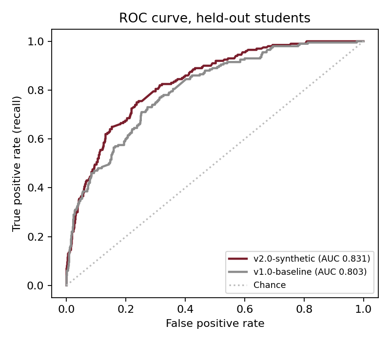
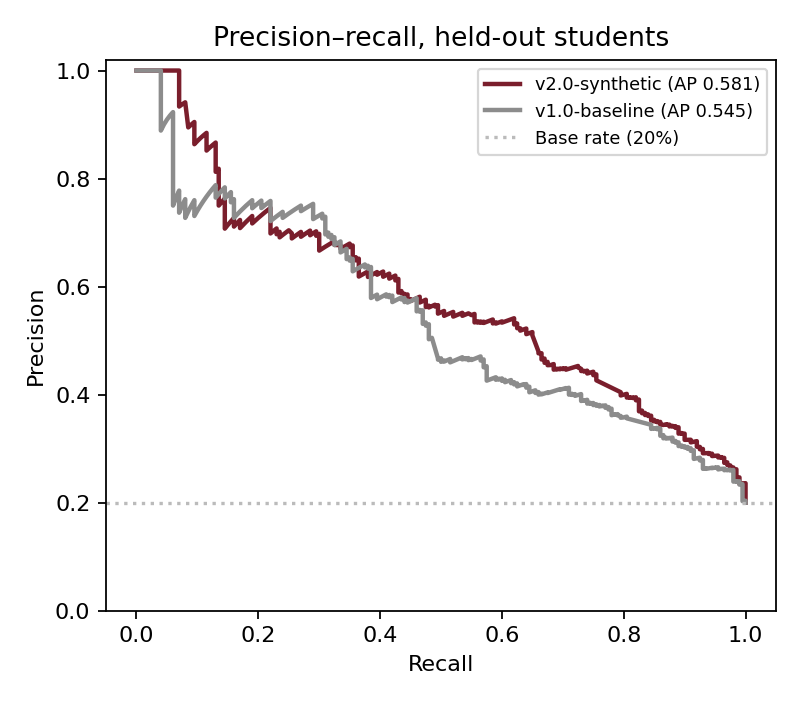
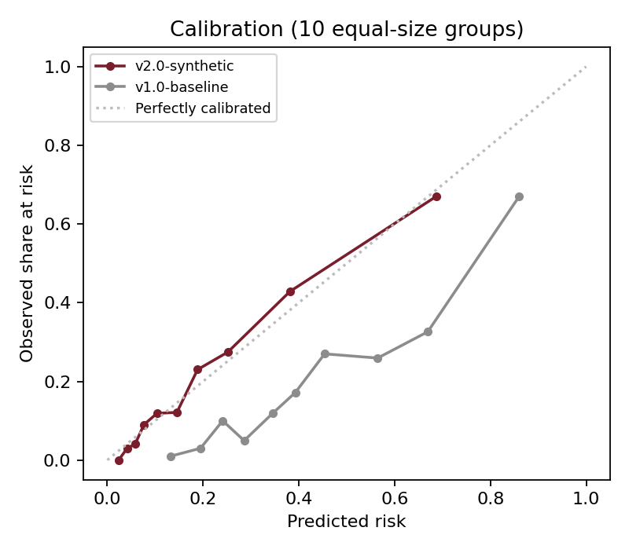
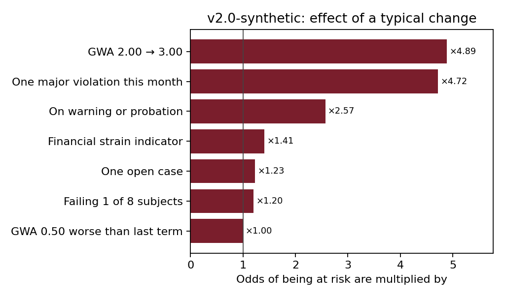
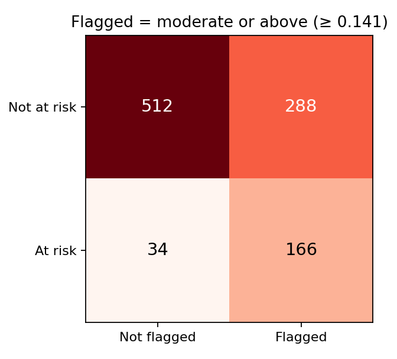

# STARS risk model v2.0-synthetic: training and evaluation

Generated by `ml/train.py` on 2026-10-29. Rerun it to reproduce every number here.

> **Synthetic data.** The model was trained and tested on 4000 synthetic past students
> made by `ml/generate_synthetic.py`, shaped like STARS records (TUPM-YY-NNNN numbers, programs,
> colleges, rating slips, disciplinary counts). These figures show that the training and evaluation
> pipeline works and how the model behaves; they do **not** say how it will do on real TUP students.
> Retraining on historical OSA records, with the same scripts, is what would.

## Data

| | |
|---|---|
| Students | 4000 (3000 to train, 1000 held out) |
| At risk in 2nd Sem 2024-2025 | 20.0% |
| Inputs taken from | 2nd Sem 2023-2024 and 1st Sem 2024-2025 |
| Missing latest rating slip (imputed, as the app does) | 8.7% |
| First-years with no earlier term (grade trend imputed) | 29.1% |

"At risk" means that in the outcome term the student failed a quarter or more of their units,
fell to warning, probation or dismissal, or did not enrol again.

Attendance is not an input: the OSA has no attendance data, so the app always fills it with a
neutral value, and a weight for a constant would mean nothing. It ships with weight 0.

## Method

- Inputs are normalized by `ml/features.py`, a line-for-line port of `normalizeFeatures()` in
  `src/lib/risk/score.ts`; `normalize-parity.test.ts` checks the two agree on 39 students.
- Logistic regression with L2 regularization, fitted with every weight kept at zero or above, and
  evaluated with scikit-learn 1.6.1. Each input is defined so that a higher value means more risk,
  and the app shows a negative contribution to staff as a protective factor. Unconstrained, inputs that
  overlap (an open case is always a recent violation; failed units are inside the GWA) can trade
  weight and come out negative, which would tell an officer that a pending case lowers risk.
  Constraining the signs is the usual remedy in scorecards; the unconstrained weights are shown
  below for comparison (held-out AUC 0.831 unconstrained, 0.831 constrained).
- Regularization strength chosen by 5-fold cross-validation on the training students: C = 46.42.
- Cross-validated ROC AUC on the training students: **0.810 ± 0.021**.
- Tier cut points chosen from out-of-fold predictions on the training students, never the held-out ones:
  moderate flags 80% of at-risk students; high and critical are the first cuts where 60% and 80% of
  those flagged are at risk.
- The held-out students were scored once, after everything above was fixed.

## Results on the 1000 held-out students

| Measure | v2.0-synthetic | v1.0-baseline |
|---|---|---|
| ROC AUC (ranking) | **0.831** | 0.803 |
| Average precision (PR AUC) | **0.581** | 0.545 |
| Brier score (lower is better) | **0.120** | 0.173 |
| Flag cut point (moderate) | 0.141 | 0.35 |
| Accuracy at that cut | 0.678 | 0.605 |
| Precision (flagged who were at risk) | 0.366 | 0.320 |
| Recall (at-risk students flagged) | 0.830 | 0.865 |
| F1 | 0.508 | 0.467 |

Confusion matrix, flagged = moderate or above:

| | Not flagged | Flagged |
|---|---|---|
| Not at risk | 512 | 288 |
| At risk | 34 | 166 |

(v1.0-baseline at its own cut: TN 432, FP 368, FN 27, TP 173.)

### Tiers

Cut points: moderate 0.141, high 0.353, critical 0.599.

| Tier | Students | Share | Actually at risk |
|---|---|---|---|
| Critical | 62 | 6.2% | 71.0% |
| High | 95 | 9.5% | 48.4% |
| Moderate | 297 | 29.7% | 25.6% |
| Low | 546 | 54.6% | 6.2% |

## Weights

Each weight is the change in log-odds when its input goes from 0 to 1 (inputs are normalized to 0–1).
Intercept -4.458 (v1.0-baseline -3.20).

| Input | Key | v2.0-synthetic | Unconstrained fit | v1.0-baseline |
|---|---|---|---|---|
| Disciplinary history | `violation_severity` | +6.722 | +6.699 | +1.60 |
| Academic standing (GWA) | `gwa_risk` | +6.346 | +6.502 | +2.80 |
| Failed units | `failure_ratio` | +1.427 | +1.417 | +2.40 |
| Scholastic status | `probationary` | +0.942 | +0.880 | +1.40 |
| Open cases | `open_cases` | +0.825 | +0.740 | +0.70 |
| Financial indicators | `financial_stress` | +0.345 | +0.341 | +0.90 |
| Grade trend | `gwa_delta` | +0.000 | -0.187 | +1.90 |
| Attendance | `attendance_deficit` | 0 (no data) | not trained | +2.10 |

A weight of exactly 0 means the constraint held it there: on this data that input added nothing the
others did not already carry.

The inputs are squeezed into 0–1 in different ways (one recent minor violation is only 0.09), so the
raw weights are not comparable with each other. Read them through a realistic change instead:

| Change | Odds of being at risk multiplied by |
|---|---|
| GWA 2.00 → 3.00 | ×4.89 |
| One major violation this month | ×4.72 |
| On warning or probation | ×2.57 |
| Financial strain indicator | ×1.41 |
| One open case | ×1.23 |
| Failing 1 of 8 subjects | ×1.20 |
| GWA 0.50 worse than last term | ×1.00 |

## Figures

 
 

## Limits

- Synthetic data: the relationships were written into the generator, so the model is learning
  assumptions, not TUP's reality. Its figures are not evidence of real-world accuracy.
- Logistic regression assumes each input adds to the log-odds on its own. The generator includes a
  threshold effect (risk rises faster past a 2.75 GWA) that a linear model can only approximate.
- The model is added switched off. Switching it on changes every score on the At-Risk page.
